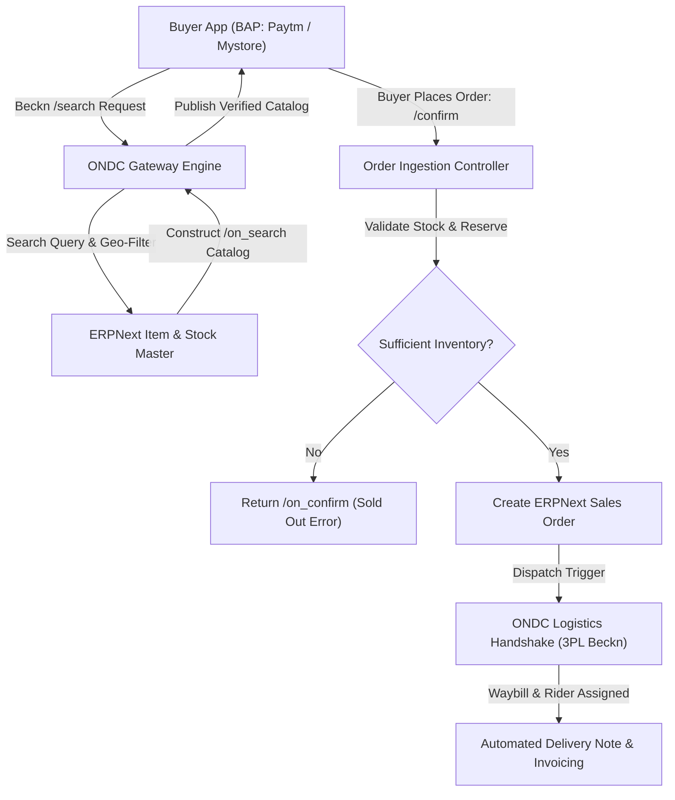

# ERPNext ONDC (Open Network for Digital Commerce) Seller Gateway

[](https://frappeframework.com/)
[](https://erpnext.com/)
[](https://becknprotocol.io/)
[]()
[](LICENSE)

## 📌 Executive Overview & Real-World Client Problem

The **Open Network for Digital Commerce (ONDC)** is revolutionizing e-commerce in India by unbundling buyers, sellers, and logistics providers over the open-source **Beckn Protocol**.

However, direct-to-consumer (D2C) brands, retailers, and distributors running ERPNext face significant friction:
1. **Beckn Protocol Complexity:** Handling asynchronous API callbacks (`/search` $\rightarrow$ `/on_search`, `/init` $\rightarrow$ `/on_init`, `/confirm` $\rightarrow$ `/on_confirm`) requires a robust event-driven gateway.
2. **Catalog & Real-Time Stock Drift:** Publishing stock to multiple buyer apps (Paytm, Magicpin, Mystore) without atomic inventory reservation leads to overselling and high cancellation penalties.
3. **Logistics Handshake Failures:** Matching on-network 3PL logistics (Shadowfax, Dunzo, Delhivery) with warehouse dispatch workflows inside ERPNext is traditionally manual.

This Frappe application implements an enterprise Beckn-compliant Seller App (BPP) gateway that connects ERPNext Item Masters, Pricing Rules, and Delivery Notes directly to the ONDC network.

---

## 🏛️ System Architecture Flow



---

## 🚀 Key Engineering Capabilities

- **Beckn Core Protocol Compliance:** Full support for Beckn transaction lifecycle across B2B and B2C retail categories.
- **Atomic Stock Reservation:** Prevents inventory drift by holding stock allocations during active buyer checkout sessions.
- **Dynamic Catalog Exporter:** Automatically publishes verified ERPNext items with GST rates, HSN codes, and images.
- **Automated Settlement & Recon:** Tracks buyer app commission payouts, logistics deductions, and net payouts into Frappe Accounts.

---

## 📂 Frappe DocType Schema & Data Structure

```text
ondc_seller_gateway/
├── ondc_seller_gateway_core/
│   ├── doctype/
│   │   ├── ondc_bpp_setting/
│   │   │   ├── ondc_bpp_setting.json
│   │   │   ├── ondc_bpp_setting.py
│   │   │   └── ondc_bpp_setting.js
│   │   └── ondc_order_transaction/
│   │       └── ondc_order_transaction.json
│   └── workspace/
│       └── ondc_seller_gateway_workspace/
│           └── ondc_seller_gateway_workspace.json
```

---

## ⚡ Frappe Hooks & Whitelisted APIs

- **REST Endpoint:** `POST /api/method/ondc_seller_gateway.api.handle_search_intent`
- **Whitelisted Method:** `@frappe.whitelist() def process_on_confirm_order(transaction_id, bap_id, item_id, quantity, delivery_pincode)`
- **Hooks Event:** `on_submit` of `Sales Order` triggers Beckn fulfillment status updates.

---

## 🛠️ Installation & Bench Setup

```bash
bench get-app https://github.com/shyampandey1104/erpnext-ondc-network-seller-gateway
bench --site erp.yourdomain.com install-app ondc_seller_gateway
bench --site erp.yourdomain.com migrate
python3 -m unittest discover tests
```

---

## 📄 License
MIT License. Built for D2C brands, FMCG manufacturers, and modern digital merchants.
